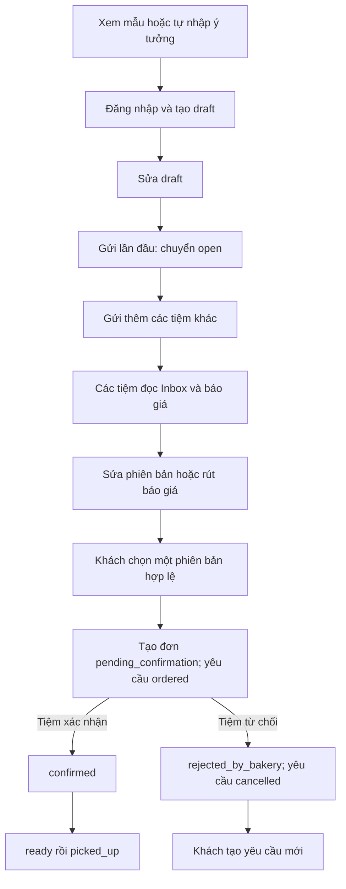

# DeCakes — hồ sơ nghiệp vụ hệ thống

**Bản làm việc ngày 22/10/2026 — dùng để thảo luận, phân tích, thiết kế và hoàn thiện sản phẩm.**

Tài liệu tổng hợp yêu cầu người dùng đã cung cấp, các quyết định đã xác nhận, mã nguồn và SQL đang có trong repository. Đây không phải tuyên bố rằng mọi tính năng đã hoàn thành hoặc mọi đề xuất đã được duyệt. Không chứa thông tin đăng nhập, không cho phép tự thay đổi Aiven.

## 1. Cách đọc và mức độ xác nhận

| Nhãn | Ý nghĩa |
| --- | --- |
| **Đã chốt** | Được xác nhận trong trao đổi về dự án; thay đổi cần quyết định mới |
| **Đã có mã** | Tìm thấy implementation trong checkout; không đồng nghĩa đã triển khai lên môi trường thật |
| **SQL hỗ trợ** | Có bảng/cột/procedure/ràng buộc; có thể chưa có API hoặc giao diện |
| **Đề xuất** | Phương án để nhóm cân nhắc, chưa được phép coi là yêu cầu cuối cùng |
| **Chưa chốt** | Cần quyết định trước khi viết phần code phụ thuộc |

Yêu cầu nghiệp vụ mô tả điều sản phẩm cần làm; SQL chỉ là một cách hiện thực. Nếu hai bên khác nhau, phải ghi nhận và thống nhất, không mặc nhiên lấy SQL làm quyết định kinh doanh.

## 2. Mục tiêu và mô hình sản phẩm

DeCakes là website kết nối khách có nhu cầu đặt bánh theo yêu cầu với nhiều tiệm bánh. Khách mô tả mong muốn, gửi cùng một yêu cầu đến các tiệm, so sánh báo giá và chọn một tiệm. Tiệm xác nhận đơn trước khi thực hiện.

Giá trị chính:

- Khách diễn đạt ý tưởng bằng nội dung và ảnh tham khảo, có ngân sách và ngày nhận.
- Các tiệm báo giá trên cùng một yêu cầu, có lịch sử sửa đổi rõ ràng.
- Khách chốt một phương án cụ thể; đơn giữ lại giá, nội dung và thời gian đã thống nhất.
- Tiệm kiểm tra khả năng thực hiện và xác nhận cam kết cuối cùng.
- Quản trị viên theo dõi hệ thống và vận hành trong phạm vi quyền được xây dựng.

**Đã chốt:** gửi báo giá là cam kết sơ bộ về khả năng làm bánh; sau khi khách chọn, tiệm xác nhận đơn là bước chốt cuối. Không có bước xác nhận khả năng riêng trước báo giá trong flow đã chốt.

**Đã chốt:** mỗi yêu cầu tạo tối đa một đơn. Nếu tiệm từ chối đơn, khách tạo yêu cầu mới, không quay lại chọn báo giá khác trong yêu cầu cũ.

**Cập nhật đã chốt ngày 22/10/2026:** chủ tiệm tự đăng ký, tạo hồ sơ và chờ admin duyệt. Tiệm phải đăng ký gói dịch vụ; miễn phí 30 ngày bắt đầu khi admin duyệt, sau đó trả phí theo gói tháng/năm qua cổng thanh toán tự động xác nhận. Gói tính theo từng tiệm, owner/staff cùng dùng quyền của gói tiệm. Hết hạn chặn giao dịch mới nhưng vẫn xem lịch sử, xử lý đơn đã có và gia hạn. Owner mời/gỡ staff; staff không quản lý thành viên hoặc mua/đổi gói. Mỗi email một role; có xác minh email, quên/đặt lại và đổi mật khẩu trong đợt Accounts. Giá chưa chốt; nhà cung cấp đang được đề xuất. Xem [đặc tả Accounts và quyền sử dụng](ACCOUNTS_AUTHORIZATION_PLAN.md).

## 3. Phạm vi phiên bản hiện tại

### Trong luồng sản phẩm cần hoàn thiện

- Đăng ký/đăng nhập khách hàng; tài khoản và quyền của người dùng tiệm, quản trị viên.
- Xác minh email, quên/đặt lại và đổi mật khẩu; thiết kế cơ chế thu hồi phiên tương ứng.
- Chủ tiệm tự đăng ký hồ sơ chờ admin duyệt; đăng ký gói theo tiệm, miễn phí ban đầu 30 ngày rồi trả phí.
- Thu phí gói tháng/năm qua cổng tự động xác nhận; giá và nhà cung cấp được cấu hình sau khi chốt.
- Xem tiệm và mẫu bánh công khai.
- Tạo yêu cầu riêng hoặc yêu cầu lấy cảm hứng từ mẫu bánh.
- Gửi cùng yêu cầu đến nhiều tiệm.
- Tiệm xem yêu cầu được gửi đến mình.
- Tạo, sửa phiên bản, rút và xem báo giá.
- Khách chọn một báo giá để tạo đơn.
- Tiệm xác nhận hoặc từ chối đơn.
- Theo dõi tiến trình sẵn sàng/đã nhận, sau khi quyền chuyển trạng thái được chốt.
- Ảnh mẫu/ảnh tham khảo/ảnh thiết kế, sau khi lưu trữ và phân quyền file được chốt.
- Trang quản trị, trước mắt là tra cứu và thống kê.

### Chưa thuộc luồng bắt buộc hiện tại

- AI tạo ảnh: tùy chọn, làm sau; ảnh AI không thay thế xác nhận khả năng của tiệm.
- Chưa có phạm vi triển khai thanh toán tiền bánh, đặt cọc, hoàn tiền đơn bánh, giao hàng, chat, đánh giá, mã giảm giá hoặc thông báo tự động.
- Chưa có quy tắc hoa hồng giao dịch, tự trừ tiền định kỳ hoặc công nhận doanh thu. Thu phí gói thuộc phạm vi ở trên; thanh toán tiền bánh chưa thuộc phạm vi.
- Chưa có giỏ hàng hoặc mua nhiều sản phẩm như website bán hàng thông thường.
- Xem mẫu hiện dẫn đến tạo yêu cầu và nhận báo giá, chưa có mua mẫu ngay với giá niêm yết cố định.

Các mục ngoài phạm vi không có nghĩa sản phẩm cấm vĩnh viễn; muốn thêm cần mô tả và đánh giá riêng.

## 4. Thuật ngữ cần thống nhất

| Thuật ngữ | Ý nghĩa |
| --- | --- |
| User | Tài khoản đăng nhập website |
| Customer | User có vai trò khách hàng |
| Bakery | Hồ sơ tiệm, không phải tài khoản đăng nhập |
| Bakery member | Liên kết một user vai trò bakery với một tiệm; có owner/staff và trạng thái thành viên |
| Cake | Mẫu bánh của tiệm trong Catalog; giá là tham khảo |
| Design request | Yêu cầu đặt bánh của một khách, có thể gửi nhiều tiệm |
| Request bakery | Một lần gửi một yêu cầu đến một tiệm; có trạng thái phản hồi riêng |
| Quote | Một phiên bản báo giá của một tiệm cho một yêu cầu |
| Current quote | Phiên bản đang chiếm vị trí hiện hành theo SQL; không tự chứng minh chưa hết hạn |
| Order | Đơn hình thành khi khách chọn một báo giá; lúc mới tạo còn chờ tiệm xác nhận |
| Order snapshot | Bản chốt agreed_* sao chép từ phiên bản báo giá và ảnh tại lúc khách chọn |
| Media asset | Bản ghi ảnh có URL, loại, người tải, phạm vi sở hữu và liên kết nghiệp vụ |
| Demo | Dữ liệu minh họa được đánh dấu is_demo; không phải tự động là dữ liệu công khai |
| Admin website | User có system_role=admin; khác hoàn toàn tài khoản quản trị MySQL avnadmin |

## 5. Tác nhân và quyền

| Tác nhân | Phạm vi được phép | Giới hạn quan trọng |
| --- | --- | --- |
| Khách chưa đăng nhập | Xem Catalog công khai | Không đọc yêu cầu/báo giá/đơn riêng tư |
| Customer | Làm việc với yêu cầu, báo giá và đơn của chính mình | Không tự đổi chủ sở hữu, role hoặc trạng thái do server quản lý |
| Bakery owner active | Thao tác nghiệp vụ của đúng tiệm có membership active; đã chốt owner mời/gỡ staff và mua/đổi gói | Không mặc nhiên đọc tiệm khác; API quản lý nhân viên/gói chưa triển khai |
| Bakery staff active | Đọc Inbox; SQL cho tạo/sửa/rút báo giá và quyết định đơn trong đúng tiệm | Hiện owner/staff chưa có khác biệt cho các procedure này; không tự suy ra staff được quản lý tiệm/nhân viên |
| Admin | Hiện tra cứu dashboard, users, bakeries; công cụ vận hành tạo admin mới | Không mặc nhiên được đặt hộ khách, báo giá hộ tiệm hoặc thực hiện các thao tác quản trị ghi chưa xây |
| User disabled | Không đăng nhập hoặc tiếp tục dùng phiên cũ | Kể cả có cookie hoặc membership, vẫn bị kiểm tra lại |
| Member removed | Không làm việc trong tiệm đã bị gỡ | Giữ bản ghi lịch sử, không xóa để phá liên kết báo giá/đơn |

**Hiện có và đã chốt giữ nguyên:** mỗi user/email chỉ có một system_role: customer, bakery hoặc admin. Muốn vừa là khách vừa là người dùng tiệm thì dùng hai tài khoản với email khác nhau. Một user bakery có thể liên kết nhiều tiệm theo schema; một tiệm có nhiều thành viên. Giới hạn nghiệp vụ số tiệm và chuyển owner chưa chốt.

Actor lấy từ phiên đã xác thực. User gửi một id trên route/body không đồng nghĩa có quyền với đối tượng đó.

## 6. Đối tượng nghiệp vụ và thông tin chính

| Đối tượng | Thông tin cần hiểu |
| --- | --- |
| Tài khoản | Email duy nhất theo collation hiện tại, họ tên, điện thoại tùy chọn, hash mật khẩu, role, trạng thái |
| Tiệm | Tên, slug duy nhất, mô tả, địa chỉ, thành phố, điện thoại, trạng thái hồ sơ |
| Thành viên tiệm | Tiệm, user, owner/staff, active/removed |
| Mẫu bánh | Tiệm sở hữu, tên, mô tả, hương vị, kích thước, giá tham khảo có thể trống hoặc bằng 0, visibility |
| Yêu cầu | Khách sở hữu, tiêu đề, ý tưởng, ngân sách, kích thước/số phần, hương vị, chữ trên bánh, ngày nhận, mẫu cảm hứng tùy chọn |
| Lần gửi | Yêu cầu, tiệm nhận, trạng thái riêng, lý do từ chối, thời gian gửi/phản hồi |
| Ảnh | Loại, URL, MIME, kích thước ảnh, người tải, liên kết yêu cầu/mẫu/tiệm, phiên bản khi phù hợp |
| Báo giá | Yêu cầu, tiệm, phiên bản, giá, nội dung cam kết, ngày nhận đề xuất, hạn chấp nhận, ảnh thiết kế tùy chọn, trạng thái |
| Đơn | Khách, tiệm, yêu cầu, báo giá được chọn, bản chốt, trạng thái quyết định/tiến trình, các thời gian liên quan |

Schema có 9 bảng nghiệp vụ và schema_migrations. Không có bảng thanh toán, thông báo, refresh token, lịch công suất hoặc nhật ký đầy đủ mọi chuyển trạng thái.

## 7. Luồng tổng thể

Sơ đồ mô tả toàn luồng mục tiêu. Việc đánh dấu đã xem, từ chối yêu cầu trước báo giá, hủy bởi khách và các nhánh tự động hết hạn chưa được chốt đủ để coi là flow đã phê duyệt.

## 8. Luồng khách hàng

### UC-C01 — Xem tiệm và mẫu bánh

- Không bắt buộc đăng nhập.
- Tiệm công khai phải active và không demo.
- Mẫu công khai phải published, không demo, thuộc tiệm active không demo.
- Mẫu/tiệm không tồn tại hoặc không công khai không được trả qua detail public.
- Có phân trang; danh sách mẫu có thể lọc theo tiệm.
- Giá tham khảo không thay cho giá báo cuối cùng; hiện Catalog chưa trả ảnh.

### UC-C02 — Đăng ký và đăng nhập

- Đăng ký công khai chỉ tạo customer active, không demo.
- Email trùng bị từ chối; không cho client chọn admin/bakery.
- Mật khẩu hiện yêu cầu 12–128 ký tự, không trim; chỉ lưu hash.
- Sai email/mật khẩu, hash trống/hỏng hoặc tài khoản disabled đều dùng thông báo đăng nhập thất bại chung.
- Phiên cookie tối đa 2 giờ, không tự kéo dài; quyền/trạng thái user được kiểm tra lại khi dùng phiên.
- Chưa có mã xác minh email, quên/đổi mật khẩu hoặc thu hồi từng phiên trên server. Đã chốt xây xác minh, quên/đặt lại và đổi mật khẩu trong đợt này; phải thiết kế thu hồi phiên sau thay mật khẩu.

### UC-C03 — Tạo và sửa yêu cầu

Thông tin bắt buộc hiện tại: title, ideaDescription, budgetMax và pickupAt. Thông tin tùy chọn: budgetMin, sizeDescription, servings, flavor, inscriptionText và inspiredByCakeId. Ảnh tham khảo là yêu cầu sản phẩm nhưng chưa có upload trong code.

- User phải là customer active.
- Yêu cầu mới là draft, VND, is_demo=0; customer_id do server gán.
- BudgetMax > 0; BudgetMin nếu có phải >= 0 và <= max.
- Số phần nếu có phải dương; chưa bắt buộc có kích thước hoặc số phần ở bước yêu cầu.
- Thời gian nhận phải ở tương lai, có múi giờ rõ ràng; server lưu UTC.
- Mẫu cảm hứng hiện được kiểm tra published/tiệm active. Điều kiện loại demo chưa đồng nhất với Catalog, cần sửa theo chính sách được chốt.
- **Quy tắc ứng dụng đã dùng:** chỉ sửa nội dung khi draft. SQL cũ ghi chú cho phép draft/open nhưng ứng dụng chặt hơn để các tiệm nhận cùng nội dung.
- Không đọc hoặc sửa yêu cầu của khách khác. Yêu cầu không có hoặc không thuộc mình đều trả 404.

### UC-C04 — Gửi cùng yêu cầu đến nhiều tiệm

- Gửi từng tiệm, mỗi lần là một giao dịch độc lập.
- Yêu cầu phải draft/open, thuộc khách và ngày nhận chưa qua; tiệm phải active.
- Mỗi cặp yêu cầu–tiệm chỉ có một lần gửi. Gửi trùng bị từ chối, không tạo dòng thứ hai.
- Lần đầu chuyển draft -> open. Gửi thêm tiệm không tạo yêu cầu mới.
- Nhiều lần gửi có thể thành công một phần; không hiển thị như tất cả cùng thành công nếu có lỗi.
- Khi kết nối đứt mà chưa rõ kết quả, xem lại danh sách tiệm đã nhận trước khi gửi lại.

### UC-C05 — So sánh báo giá và chọn

- **SQL hỗ trợ, API chưa có lúc lập tài liệu.**
- Khách chỉ xem báo giá của yêu cầu mình.
- Cần phân biệt phiên bản cũ, bản bị rút, hết hạn và bản có thể chọn; không chỉ nhìn trạng thái submitted.
- Giá, hương vị, kích thước, trang trí, chữ trên bánh, ngày nhận và ảnh chốt phải được thể hiện cho khách trước khi chọn.
- Chọn qua sp_accept_quote: yêu cầu open, quote submitted, chưa hết hạn, tiệm active, ảnh nếu có phải đúng phạm vi.
- Thành công tạo một đơn pending_confirmation, chuyển yêu cầu ordered, quote được chọn accepted và các quote submitted còn lại not_selected.
- Không nhận giá cuối cùng hoặc chủ đơn từ client; server lấy phiên bản báo giá đã khóa để tạo bản chốt.
- Chọn đồng thời nhiều báo giá chỉ được tạo một đơn.
- SQL hiện chưa kiểm tra lại giờ nhận còn ở tương lai khi chọn: đây là khoảng trống cần xử lý trước hoàn thiện.

### UC-C06 — Theo dõi và nhận bánh

- Đơn mới chỉ là chờ tiệm xác nhận, chưa phải tiệm đã nhận làm cuối cùng.
- Tiệm confirm thì đơn confirmed; reject thì rejected_by_bakery và yêu cầu cancelled.
- Sau reject khách tạo yêu cầu mới; không chọn tiếp báo giá khác trong yêu cầu cũ.
- Tiến trình ready/picked_up có trong schema, nhưng ai được đánh dấu và điều kiện chi tiết chưa chốt.
- Quyền hủy trước/sau confirmed, thời gian chờ và tự động hết hạn chưa chốt.

## 9. Luồng của tiệm

### UC-B01 — Đăng ký tiệm và thành viên

- Chưa có API tạo tài khoản bakery, tạo hồ sơ và owner membership.
- Đã chốt: chủ tiệm tự đăng ký, tạo hồ sơ, chờ admin duyệt và phải đăng ký gói theo tiệm; miễn phí ban đầu 30 ngày, sau đó trả phí. Owner/staff dùng chung quyền gói của tiệm.
- Đã chốt trial bắt đầu khi admin duyệt; hết hạn chặn giao dịch mới, vẫn xem lịch sử/xử lý đơn đã có/gia hạn. Thu phí qua cổng tự động theo tháng/năm; giá chưa chốt. Không đồng nhất trạng thái tài khoản, hồ sơ và gói.
- Nếu tạo đồng thời user/tiệm/owner, phải bảo đảm không tồn tại nửa quy trình khi một bước lỗi.
- Đã chốt owner mời/gỡ staff; staff không quản lý thành viên hoặc mua/đổi gói. Chi tiết nhận lời mời, chuyển owner, giới hạn số tiệm và hồ sơ tối thiểu trước active còn cần thiết kế/chốt.
- Không dùng việc chia sẻ tài khoản MySQL backend để thay cho tài khoản website của từng nhân viên.

### UC-B02 — Đọc Inbox

- Đã có mã: danh sách tiệm của tôi, danh sách và chi tiết yêu cầu đã gửi tới từng tiệm.
- User phải active, role bakery và có membership active của đúng tiệm; owner/staff đều đọc được.
- Tiệm draft/pending_review/suspended vẫn được thành viên active đọc lịch sử.
- Không đọc các yêu cầu chưa gửi tới tiệm hoặc dữ liệu của tiệm khác.
- Không trả thông tin tài khoản khách như email/điện thoại/hash; thông tin cần giao nhận sau khi có đơn chưa được chốt hợp đồng.
- GET không tự đổi pending -> viewed hoặc ghi thời gian; quy tắc đánh dấu đã xem là quyết định riêng.

### UC-B03 — Tạo báo giá

- **SQL hỗ trợ, API chưa có lúc lập tài liệu.**
- Thành viên active của đúng tiệm; tiệm active; yêu cầu open và đã gửi tới tiệm; lần gửi chưa declined.
- Chưa có phiên bản hiện hành cho cặp yêu cầu–tiệm.
- Giá > 0; có kích thước hoặc số phần; flavor và decoration bắt buộc; ngày nhận đề xuất và hạn báo giá phải ở tương lai khi tạo.
- SQL không bắt giá nằm trong budgetMax hoặc ngày nhận đề xuất khớp yêu cầu: chính sách sản phẩm còn mở.
- Procedure tạo quote submitted, revisionNo tăng theo lịch sử; lần gửi chuyển quoted và ghi respondedAt khi cần.
- Ảnh thiết kế là tùy chọn theo SQL. Quyền upload và quy tắc bắt buộc ảnh chưa được quyết định.

### UC-B04 — Sửa hoặc rút báo giá

- Sửa gọi sp_revise_quote: phải nhắm đúng phiên bản submitted hiện hành của tiệm.
- Bản cũ chuyển superseded; bản mới có id mới và revisionNo tiếp theo; không sửa nội dung lịch sử.
- Hai lần sửa cùng bản cũ không được tạo hai bản hiện hành.
- SQL cho revise bản submitted đã hết hạn, miễn nội dung/thời gian bản mới hợp lệ.
- Rút chuyển submitted -> withdrawn. Tiệm không còn active vẫn được rút nếu user/membership còn active.
- Báo giá accepted không được sửa hoặc rút.
- Rút xong có thể tạo báo giá mới theo điều kiện procedure, vẫn tiếp tục số phiên bản.
- Rút không tự chuyển request_bakeries khỏi quoted. Giao diện phải đọc trạng thái quote thực tế.

### UC-B05 — Quyết định đơn

- **SQL hỗ trợ, API chưa có lúc lập tài liệu.**
- Thành viên active của đúng tiệm thao tác đơn pending_confirmation.
- Confirm yêu cầu tiệm active; ghi người quyết định và thời điểm, đơn thành confirmed.
- Reject được phép khi tiệm không active; ghi quyết định/lý do, đơn thành rejected_by_bakery, yêu cầu cancelled.
- SQL chưa bắt buộc lý do reject; sản phẩm cần quyết định có bắt buộc không.
- Sau reject, quote đã chọn vẫn accepted, phản ánh lịch sử khách đã chọn chứ không phải đơn còn hiệu lực.
- Không tự mở lại đơn đã quyết định; không đổi giá hoặc agreed_* khi confirm.

### UC-B06 — Thực hiện và bàn giao

- Schema mô tả confirmed -> ready -> picked_up, nhưng chưa có API/procedure cho hai bước này.
- Chưa có lịch sản xuất, quản lý công suất, tồn kho, ca làm hoặc tính tự động thời gian chuẩn bị.
- Không thể khẳng định hệ thống tự bảo đảm tiệm còn công suất; trong phạm vi hiện tại tiệm tự đánh giá khi báo giá/xác nhận.
- Cần chốt người đánh dấu đã nhận, cách xử lý nhận trễ và hủy sau confirmed trước khi triển khai.

## 10. Luồng quản trị viên

### Admin giai đoạn 1 đang có trong checkout

- Dùng đăng nhập Accounts hiện hữu, policy Admin; không có login thứ hai hoặc đăng ký admin công khai.
- Dashboard đếm tài khoản theo role/status, tiệm theo profileStatus, yêu cầu và đơn theo trạng thái.
- Tra cứu users: tìm email/họ tên, lọc role/status/isDemo, phân trang và xem chi tiết.
- Tra cứu bakeries: tìm tên/slug, lọc profileStatus/isDemo, phân trang và xem chi tiết.
- Admin xem được dữ liệu không public để vận hành; không áp bộ lọc active/published của Catalog cho admin.
- isDemo không truyền nghĩa là gồm cả demo/thật; có thể lọc rõ ràng.
- Không trả hoặc SELECT password_hash trong truy vấn tra cứu user.
- Dashboard chưa phải báo cáo doanh thu; chưa có dữ liệu thanh toán.
- Công cụ bootstrap vận hành tạo user admin mới, không tự nâng role tài khoản có sẵn, không tự chạy lúc khởi động.

### Chưa có và chưa được ngầm phê duyệt

- Duyệt/kích hoạt/suspend tiệm.
- Khóa/mở user, đổi role, reset mật khẩu hoặc chuyển quyền owner.
- Xử lý/hủy đơn thay các bên, sửa giá/báo giá hoặc đăng nhập mạo danh.
- Audit log quản trị đầy đủ, workflow khiếu nại, frontend admin.

Quản trị chỉ đọc vẫn có giá trị trước khi các chính sách trên được chốt. Mở quyền sửa phải xác định rõ quyền actor, điều kiện, lý do, ảnh hưởng phiên và lịch sử.

## 11. Danh mục trạng thái

| Đối tượng | Trạng thái | Ý nghĩa |
| --- | --- | --- |
| User | active / disabled | Được dùng tài khoản / bị vô hiệu hóa |
| Bakery profile | draft / pending_review / active / suspended | Đã chốt cần admin duyệt; API duyệt, lý do từ chối và gửi lại chưa triển khai/chốt chi tiết |
| Membership | active / removed | Thành viên còn quyền / đã bị gỡ |
| Cake | draft / published / hidden | Mẫu nháp / đã công bố / ẩn |
| Design request | draft / open / ordered / cancelled | Nháp / đã gửi và có thể nhận báo giá / đã chọn tạo đơn / đã hủy hoặc đóng do tiệm từ chối |
| Request bakery | pending / viewed / quoted / declined | Chờ phản hồi / đã xem / từng được báo giá / tiệm từ chối yêu cầu |
| Quote | submitted / superseded / withdrawn / accepted / not_selected | Đã gửi / bị thay bởi bản mới / đã rút / khách chọn / không được chọn |
| Order | pending_confirmation / confirmed / rejected_by_bakery / ready / picked_up / cancelled | Chờ tiệm / xác nhận / tiệm từ chối / sẵn sàng / đã nhận / hủy |

Các điểm dễ hiểu sai:

- ordered không có nghĩa đã làm xong; đây là trạng thái yêu cầu khi đã tạo đơn.
- accepted không có nghĩa đơn đã confirmed.
- quoted không có nghĩa đang có báo giá còn hạn.
- submitted có thể đã hết hạn; không có trạng thái expired lưu trong SQL.
- pending_review có trong schema không đồng nghĩa admin duyệt đã có API.
- Số lượng CHECK hợp lệ trong schema không thay thế kiểm tra chuyển trạng thái giữa các bước.

## 12. Các bất biến phải giữ

| ID | Quy tắc |
| --- | --- |
| INV-01 | Một yêu cầu thuộc đúng một customer |
| INV-02 | Một cặp yêu cầu–tiệm chỉ có một dòng lần gửi |
| INV-03 | Chỉ tiệm đã nhận yêu cầu mới được báo giá |
| INV-04 | Mỗi dòng quote là một phiên bản; nội dung phiên bản không bị ghi đè |
| INV-05 | Mỗi cặp yêu cầu–tiệm có tối đa một current_slot=1, nhưng điều đó chưa bảo đảm còn hạn |
| INV-06 | Một yêu cầu tạo tối đa một đơn; một quote tạo tối đa một đơn |
| INV-07 | Customer/tiệm/yêu cầu của đơn khớp đúng quote đã chọn |
| INV-08 | Nội dung agreed_* của đơn là bản chốt; không thay theo thay đổi nguồn về sau |
| INV-09 | Mất quyền tài khoản hoặc thành viên không được tiếp tục thao tác chỉ vì biết id |
| INV-10 | Dữ liệu riêng tư chỉ được đọc trong phạm vi chủ sở hữu/thành viên/policy quản trị phù hợp |
| INV-11 | Procedure quản lý transaction phải chạy độc lập; không mở transaction ứng dụng bao quanh |
| INV-12 | Không suy ra thất bại chắc chắn/rollback chỉ từ lỗi mạng sau thao tác có thể đã commit |

SQL chống một số sai lệch bằng UNIQUE/FK/CHECK/khóa dòng. Application vẫn chịu trách nhiệm HTTP, validation, quyền đọc, trạng thái thao tác chưa có procedure và thông điệp cho người dùng.

## 13. Quy tắc tiền và thời gian

- Tiền hiện chỉ VND, lưu DECIMAL(12,2), không dùng số thực cho phép tính giá.
- Giá tham khảo có thể null/0; giá báo và giá chốt phải > 0.
- BudgetMax > 0, BudgetMin nếu có >= 0 và <= max. Quy tắc giá báo phải trong ngân sách chưa chốt.
- Thời gian lưu UTC với độ chính xác mili giây. Input ngày giờ phải có Z/offset; giao diện hiển thị theo múi giờ phù hợp, không suy ra từ giờ của server.
- Không tự rút ngắn hoặc làm tròn một thời điểm không hợp lệ để vượt validation.
- SQL kiểm tra thời gian sau khi lấy khóa trong các procedure có kiểm tra hạn, nhằm tránh dùng thời điểm cũ trong lúc chờ.
- **Khoảng trống đã xác định:** chưa bắt validUntil <= estimatedPickupAt và chưa kiểm tra lại estimatedPickupAt còn tương lai khi accept. Có thể tạo đơn hẹn nhận trong quá khứ nếu chỉ kiểm tra validUntil.
- Chưa có deadline confirm, tự hết hạn đơn hoặc quy tắc thời gian tối thiểu để làm bánh.

**Đề xuất chưa duyệt:** now < validUntil <= estimatedPickupAt; khi accept kiểm tra giờ nhận lại dưới khóa. API precheck riêng không đủ bảo vệ tranh chấp/chờ khóa. Nếu duyệt, cần thay đổi procedure qua phạm vi migration riêng; không sửa/chạy lại script cài đặt trên Aiven.

## 14. Ảnh và quyền sở hữu

| Loại | Gắn với | Quy tắc SQL |
| --- | --- | --- |
| cake_photo | Mẫu bánh và tiệm sở hữu | Tiệm trong ảnh phải khớp tiệm của mẫu |
| customer_reference | Yêu cầu của khách | Không có owner_bakery_id/cake_id |
| ai_generated | Yêu cầu | Có chỗ lưu trong schema, chưa có tính năng AI |
| design_proposal | Yêu cầu và tiệm đã nhận | Quote chỉ được dùng ảnh đề xuất thuộc chính tiệm đó |

- Quote có thể dùng ảnh customer_reference/ai_generated đúng yêu cầu hoặc design_proposal đúng tiệm/yêu cầu; không dùng trực tiếp cake_photo làm ảnh chốt quote.
- Ảnh bất biến: thay ảnh là thêm asset/file mới, không ghi đè khóa file mà đơn cũ đang tham chiếu.
- Đơn sao chép URL và thông tin ảnh tại lúc chọn; đây là một phần bản chốt khi có ảnh.
- Schema yêu cầu URL HTTPS và MIME JPEG/PNG/WebP; chưa đủ để chứng minh có kiểm tra file thật, giới hạn dung lượng hoặc phân quyền tải file.
- Chưa chọn storage, dung lượng/số ảnh tối đa, quyền công khai/riêng tư, thời hạn lưu và cách phục vụ ảnh lâu dài.
- **Đề xuất:** ảnh mẫu public; ảnh tham khảo/thiết kế private theo quyền nghiệp vụ. Không dùng URL ký sẽ hết hạn làm bản chốt duy nhất, cần khóa file ổn định và cơ chế cấp quyền xem.

## 15. Luồng lỗi và trường hợp ngoại lệ

| Tình huống | Hành vi cần thể hiện |
| --- | --- |
| Chưa đăng nhập / sai role | 401 / 403, không chuyển trang HTML từ API |
| Đối tượng riêng tư không có hoặc không thuộc phạm vi | 404 chung để không tiết lộ dữ liệu |
| Sửa yêu cầu đã open | Không sửa; báo xung đột trạng thái |
| Gửi lại cùng tiệm | Không tạo dòng mới; xem lần gửi đã có |
| Chọn bản quote superseded/withdrawn/hết hạn | Không tạo đơn; khách tải lại dữ liệu hiện hành |
| Hai lần chọn đồng thời | Chỉ một đơn; lần còn lại nhận trạng thái không còn cho phép |
| Tiệm suspended | Không nhận yêu cầu/create/revise/confirm mới; vẫn đọc lịch sử, rút quote hoặc reject pending theo điều kiện SQL |
| Tiệm từ chối đơn | Giữ lịch sử; request cancelled; tạo request mới |
| DB lỗi | Lỗi hệ thống che chi tiết; không biến thành sai mật khẩu hoặc tự đăng xuất |
| Mạng đứt sau CALL | Kết quả có thể chưa rõ; tra cứu lại, không retry mù |
| Ảnh bị thay ở storage | Không được đổi file cũ; cần cơ chế lưu bất biến và phát hiện thao tác ngoài luồng |

SQLSTATE 45000 dùng cho mã nghiệp vụ được nhận diện chính xác theo allowlist. Các lỗi khác không tự gán thành lỗi người dùng. Việc chuyển mã cụ thể sang HTTP cho Quotes/Orders phải được bổ sung khi triển khai.

## 16. Các quyết định còn mở

**D-01 đã được chốt ngày 22/10/2026:** chủ tiệm tự đăng ký, tạo hồ sơ và chờ admin duyệt, kèm đăng ký gói theo tiệm. Miễn phí ban đầu 30 ngày rồi trả phí; owner/staff cùng dùng quyền của gói tiệm.

**D-02..D-10 dưới đây vẫn chưa chốt.** Các khuyến nghị trong tài liệu rà soát chỉ là đề xuất. Chi tiết Accounts, trial và thu phí còn mở được liệt kê riêng trong [đặc tả Accounts](ACCOUNTS_AUTHORIZATION_PLAN.md#6-các-quyết-định-còn-thiếu).

| ID | Quyết định cần nhóm trả lời | Ảnh hưởng |
| --- | --- | --- |
| D-02 | Giá báo được vượt ngân sách không? Ngân sách là giới hạn cứng hay mong muốn? | Validation, so sánh báo giá, xác nhận lựa chọn |
| D-03 | Tiệm được đề xuất ngày/giờ khác yêu cầu không? | Quote, UI cảnh báo và chốt thời gian |
| D-04 | Có chốt validUntil <= estimatedPickupAt và kiểm tra giờ nhận khi accept không? | Procedure/validation, tránh đơn nhận trong quá khứ |
| D-05 | Tiệm có bao lâu để confirm? Có tự hết hạn hay cho khách hủy khi chờ? | Pending order, tác vụ nền và cạnh tranh trạng thái |
| D-06 | Ai hủy được ở draft/open/pending_confirmation/confirmed/ready? Có cần lý do và lịch sử? | Endpoint hủy và dữ liệu cần lưu |
| D-07 | Ai đánh dấu ready/picked_up, có cần khách xác nhận đã nhận không? | Tiến trình bàn giao |
| D-08 | Đánh dấu viewed bằng thao tác riêng hay tự động? Từ chối yêu cầu ở trạng thái nào, lý do có bắt buộc không? | Inbox ghi, cạnh tranh với create quote |
| D-09 | Ảnh lưu ở đâu, public/private thế nào, giới hạn và thời hạn lưu ra sao? | Upload, storage, bản chốt |
| D-10 | Demo bị loại khỏi toàn bộ luồng public hay chỉ danh sách Catalog? | Predicate đọc, tham khảo mẫu, gửi tiệm |

Các điểm bổ sung đã chốt: một role/email; owner mời/gỡ staff và mua/đổi gói, staff không có các quyền này; trial bắt đầu khi duyệt; hết hạn chặn giao dịch mới nhưng giữ lịch sử/xử lý đơn đã có/gia hạn; thanh toán gói tự động theo tháng/năm; xác minh email và khôi phục/đổi mật khẩu nằm trong phạm vi. Còn thiếu giá/quyền lợi gói, nhà cung cấp, chi tiết review/lời mời/gia hạn/Catalog, dữ liệu liên hệ giao nhận và hành vi nhận trễ. Thanh toán tiền bánh vẫn chưa mở phạm vi.

## 17. Tình trạng triển khai tại checkout ngày 22/10/2026

| Nhóm | Backend | SQL/data model | Ghi chú |
| --- | --- | --- | --- |
| Customer Accounts | Đã có mã cơ bản | Đã có, cần bổ sung cho chức năng mới | Đã chốt xây forgot/reset/change password và email verification; chưa triển khai |
| Catalog đọc | Đã có mã | Đã có | Chưa ảnh trong response |
| DesignRequests | Đã có mã | Đã có | Tạo/sửa draft, gửi và xem các tiệm |
| Inbox tiệm | Đã có mã, chỉ đọc | Đã có | Không tự viewed/declined |
| Admin giai đoạn 1 | Đã có mã và tài liệu riêng | Dùng schema hiện tại | Dashboard, tra cứu, bootstrap; chưa quản trị ghi qua API |
| Đăng ký tiệm/thành viên | Chưa có | Có bảng | Đã chốt tự đăng ký chờ admin duyệt, owner mời/gỡ staff; chi tiết hợp đồng còn mở |
| Gói/trial/thu phí theo tiệm | Chưa có | Chưa có | Đã chốt 30 ngày từ lúc duyệt, sau đó cổng tự động theo tháng/năm; giá/nhà cung cấp còn mở |
| Quản lý mẫu bánh | Chưa có API ghi | Có bảng | Không đồng nghĩa Catalog đọc đã hỗ trợ thêm/sửa mẫu |
| Quotes | Chưa có API/service/store | Có 3 procedure ghi | OUT parameter và tích hợp cần kiểm chứng khi triển khai |
| Orders | Chưa có API/service/store | Có accept/decide procedure | Chưa có flow chạy hoàn chỉnh qua API |
| Ready/picked_up/hủy | Chưa có API | Có trạng thái/cột, thiếu procedure riêng | Cần state machine và quyền cụ thể |
| Upload/ảnh/AI | Chưa có | Có media_assets | AI làm sau |

Đã có code không đồng nghĩa frontend đã có, Aiven đã nhận thay đổi hay chức năng đã được kiểm thử end-to-end trên môi trường triển khai. Kết quả kiểm thử kỹ thuật được ghi trong README/tests/ADMIN_PHASE1 theo từng lượt, không phải chứng nhận toàn bộ nghiệp vụ ở tài liệu này.

## 18. API đang có để nhóm đối chiếu

| Nhóm | Endpoint hiện có |
| --- | --- |
| Health | GET /api/health |
| Auth | GET /api/auth/csrf; POST /api/auth/register; POST /api/auth/login; POST /api/auth/logout; GET /api/auth/me |
| Public Catalog | GET /api/bakeries; GET /api/bakeries/{id}; GET /api/cakes; GET /api/cakes/{id} |
| Customer requests | POST /api/design-requests; GET /api/design-requests; GET /api/design-requests/{id}; PUT /api/design-requests/{id} |
| Gửi tiệm | POST /api/design-requests/{id}/bakeries/{bakeryId}; GET /api/design-requests/{id}/bakeries |
| Bakery Inbox | GET /api/bakery-workspace/bakeries; GET /api/bakery-workspace/bakeries/{bakeryId}/requests; GET /api/bakery-workspace/bakeries/{bakeryId}/requests/{requestId} |
| Admin đọc | GET /api/admin/dashboard; GET /api/admin/users; GET /api/admin/users/{id}; GET /api/admin/bakeries; GET /api/admin/bakeries/{id} |

Catalog dùng hasNext; requests/inbox và Admin dùng totalCount theo hợp đồng hiện tại. Đây là khác biệt API đang có, không tự gộp hoặc đổi hợp đồng trong một nhiệm vụ nghiệp vụ.

## 19. Kịch bản minh họa để trao đổi

Khách Lan muốn bánh sinh nhật 12 phần, vị vani, chữ “Mừng sinh nhật”, ngân sách tối đa 1.000.000 VND, nhận lúc 16:00 ngày 15/11/2026 tại múi giờ +07:00.

1. Lan tạo draft, bổ sung nội dung rồi gửi đến tiệm A và B. Nội dung khóa sửa sau lần gửi đầu.
2. A báo 680.000 VND, B báo 750.000 VND; mỗi báo giá mô tả rõ phương án và thời gian.
3. A sửa phương án: quote A-v1 superseded, A-v2 submitted. Lan phải xem bản v2, không chọn bản v1.
4. Lan chọn A-v2 còn hợp lệ: tạo một đơn pending_confirmation; B không được chọn cho yêu cầu này nữa.
5. A confirm: đơn confirmed. Khi triển khai các bước bàn giao đã được duyệt, đơn lần lượt ready rồi picked_up.
6. Nhánh khác: nếu A reject ở bước 5, đơn rejected_by_bakery và yêu cầu cancelled; Lan tạo yêu cầu mới.

Giá/ngày ở ví dụ không tự chốt chính sách cho báo giá vượt ngân sách hoặc đổi ngày nhận. Không có thanh toán phát sinh chỉ vì đơn confirmed trong mô hình hiện tại.

## 20. Ca nghiệm thu toàn luồng

| ID | Kịch bản cần chứng minh |
| --- | --- |
| AT-01 | Người chưa đăng nhập xem public, không xem dữ liệu riêng tư |
| AT-02 | Customer A không đọc/sửa/chọn dữ liệu Customer B |
| AT-03 | Member tiệm A không đổi id để thao tác tiệm B; user thuộc hai tiệm vẫn phải khớp tiệm của đối tượng |
| AT-04 | Draft sửa tranh chấp với gửi: không ghi sửa sau khi đã open |
| AT-05 | Gửi cùng cặp nhiều lần đồng thời chỉ có một lần gửi |
| AT-06 | Hai nhân viên create quote đồng thời chỉ có một phiên bản hiện hành |
| AT-07 | Revise tạo bản mới, dữ liệu bản cũ bất biến; chọn bản cũ bị chặn |
| AT-08 | Quote hết hạn hoặc bị rút không tạo đơn |
| AT-09 | Hai quote được chọn đồng thời chỉ tạo một đơn |
| AT-10 | Order snapshot không đổi khi nguồn thay đổi |
| AT-11 | Confirm/reject hoặc cancel tranh chấp chỉ có một kết quả hợp lệ theo state machine đã duyệt |
| AT-12 | Tiệm suspended không tạo cam kết mới nhưng vẫn được đọc/rút/reject theo quy tắc |
| AT-13 | Disabled/removed làm mất quyền ở request tiếp theo |
| AT-14 | Reject order giữ lịch sử, không mở lại yêu cầu |
| AT-15 | Admin tra cứu được đúng phạm vi, user thường không vào admin; không lộ hash |
| AT-16 | File ảnh tuân quyền và khóa bất biến, URL xem lại đơn vẫn dùng được theo thiết kế storage |
| AT-17 | Giờ nhận đã qua bị chặn khi accept nếu nhóm duyệt D-04; không dùng test chưa được duyệt để chứng minh quy tắc đã chốt |

## 21. Hướng hoàn thiện và phân việc

Ưu tiên mới của người dùng ngày 22/10/2026 là hoàn thiện Accounts cho customer/bakery/admin. Thứ tự còn lại là đề xuất:

1. Dùng lại Accounts và Admin giai đoạn 1 đã có, chốt hợp đồng quyền còn thiếu; xây onboarding tự đăng ký/chờ duyệt và gói/trial theo [đặc tả Accounts](ACCOUNTS_AUTHORIZATION_PLAN.md).
2. Chốt D-02 đến D-10, lập bảng chuyển trạng thái và trách nhiệm actor được duyệt trước phần code phụ thuộc.
3. Hoàn thiện thu phí theo tiệm qua cổng tự động, chu kỳ tháng/năm khi có giá/nhà cung cấp và chi tiết gia hạn; áp dụng chính sách hết hạn đã chốt, không đánh đồng thanh toán gói với tiền bánh.
4. Quotes: create/revise/withdraw/history và kiểm chứng OUT.
5. Orders: accept/read snapshot/confirm/reject, kiểm thử đồng thời.
6. Tiến trình bàn giao và các nhánh hủy đã chốt.
7. Storage/ảnh và quản lý mẫu bánh; có thể phân cho thành viên thứ hai sau khi thống nhất hợp đồng.
8. Chạy demo toàn luồng bằng dữ liệu kiểm thử và tài khoản mới; AI làm sau.

Nhóm hiện có hai người phát triển .NET. Phân công đã dùng: người thứ nhất Accounts/DesignRequests/Inbox và luồng chính; người thứ hai Catalog. Phần Admin được tách chat để giữ ngữ cảnh. Việc phân công các bước tiếp theo nên thống nhất trước khi cả hai sửa file dùng chung.

## 22. Ràng buộc kỹ thuật và vận hành liên quan nghiệp vụ

- Backend .NET 10, ASP.NET Core Controllers, Clean Architecture tinh gọn.
- Domain: khái niệm/quy tắc độc lập; Application: DTO/interface/service; Infrastructure: ADO.NET/MySqlConnector và tích hợp; Api: HTTP/auth/composition.
- MySQL 8.4 trên Aiven, database decakes_db. Repository là tham chiếu schema, không thay thế xác minh live.
- Dùng MySqlConnector 2.6.2, VerifyFull và CA Aiven, user MySQL hạn chế quyền riêng cho backend. Không dùng avnadmin cho ứng dụng.
- Không EF/scaffold/migration tự động; không chạy lại install/EnsureCreated trên database dùng chung.
- Stored procedure tự quản lý transaction, không trả result set; một số trả OUT id rồi backend SELECT lại.
- Cookie HttpOnly/Secure, HTTPS, CSRF cho phương thức ghi; session validation và lỗi che chi tiết được giữ.
- Kiểm thử ghi dùng MySQL 8.4 local disposable; không dùng Aiven làm chỗ seed/reset/thử procedure.
- Không đưa password/token/API key/connection string vào chat hoặc Git. Cấu hình từng máy qua công cụ nhập ẩn và secrets.
- Không tự commit/push/merge nếu chưa được người dùng yêu cầu. Quyền admin website không đồng nghĩa quyền quản trị MySQL.

### Procedure nghiệp vụ đã có trong SQL

| Procedure | Mục đích | OUT |
| --- | --- | --- |
| sp_send_request_to_bakery | Gửi một yêu cầu đến một tiệm | Không |
| sp_create_quote | Tạo phiên bản báo giá mới | p_quote_id |
| sp_revise_quote | Thay bản hiện hành bằng phiên bản mới | p_new_quote_id |
| sp_withdraw_quote | Rút báo giá submitted | Không |
| sp_accept_quote | Khách chọn báo giá, tạo bản chốt đơn | p_order_id |
| sp_bakery_decide_order | Tiệm confirm/reject pending order | Không |

Có thêm 5 guard phục vụ procedure, không gọi trực tiếp từ API. Không có procedure riêng cho đăng ký, quản lý Catalog, upload, viewed/declined, ready/picked_up hoặc hủy chủ động.

## 23. Thông tin cần mang theo khi làm việc tiếp

Khi trao đổi với thành viên khác hoặc AI khác, cung cấp tài liệu này cùng schema và tài liệu procedure. Yêu cầu bên nhận:

1. D-01 và các quyết định Accounts/trial/thu phí tại mục 2 đã chốt. Không coi chi tiết còn mở trong đặc tả Accounts hoặc D-02..D-10 là yêu cầu đã duyệt.
2. Thu phí gói đã nằm trong phạm vi. Không tự thêm thanh toán tiền bánh, giao hàng hoặc AI vào MVP hiện tại.
3. Không suy ra Quotes/Orders đã hoàn thành chỉ vì có procedure hoặc prompt triển khai.
4. Giữ một yêu cầu–một đơn, lịch sử phiên bản và bản chốt.
5. Nêu rõ đề xuất nào cần đổi schema/procedure và kiểm thử nào chứng minh hành vi.
6. Không đưa dữ liệu bí mật hoặc thông tin người dùng thật vào tài liệu chia sẻ.

## 24. Tài liệu nguồn

- [README và trạng thái triển khai](../README.md).
- [Rà soát các khoảng trống nghiệp vụ](BUSINESS_RULES_REVIEW.md).
- [Admin giai đoạn 1](ADMIN_PHASE1.md).
- [Schema mô tả](../database/SCHEMA.md), [SQL schema nguồn](../database/install/01_schema.sql).
- [Procedure mô tả](../database/STORED_PROCEDURES.md), [SQL procedure nguồn](../database/install/02_procedures.sql).
- [Kế hoạch backend/database](BACKEND_DATABASE_PLAN.md).
- [Hướng dẫn kiểm thử](../tests/README.md), [quy trình phát triển](DEVELOPMENT_WORKFLOW.md).

Tài liệu được tổng hợp từ yêu cầu và checkout ngày 22/10/2026; không kết nối Aiven, không tạo tài khoản thật, không thay code hoặc chính sách trong lượt tổng hợp này. Thông tin kiểm thử trong các nguồn có ngày và phạm vi riêng; không dùng kết quả lịch sử để khẳng định một quyết định nghiệp vụ còn mở đã được xác nhận.

### Kiểm tra tài liệu và nền kỹ thuật trong lượt tổng hợp

- Lượt tổng hợp đầu: đối chiếu controller/schema/tài liệu nguồn và kiểm tra 10 liên kết tương đối: PASS; 17 kịch bản nghiệm thu. Sau cập nhật Accounts, D-01 đã chốt, D-02..D-10 và các điểm chi tiết được ghi riêng trong đặc tả Accounts còn mở. Không dùng kết quả kiểm tra liên kết của lượt đầu làm bằng chứng cho nội dung bổ sung.
- `dotnet build DeCakes.slnx --no-restore -m:1 -nr:false`: thành công, 0 lỗi, 1 cảnh báo NU1900 ở công cụ bootstrap do không tải được metadata kiểm tra lỗ hổng từ NuGet. Không coi đây là xác nhận dependency không có lỗ hổng.
- `dotnet test DeCakes.slnx --no-build --no-restore -m:1 -nr:false --filter 'FullyQualifiedName!~MySqlUserAccountStoreTests' --verbosity minimal`: Application 150 PASS, API 181 PASS, Infrastructure 40 PASS và 45 SKIP. Biến MySQL test được tạm bỏ khỏi process và khôi phục ở finally; 10 ca Accounts MySQL bị loại bằng filter. Tổng 371 PASS, không có FAIL.
- MySQL thật/Aiven và nghiệp vụ chưa triển khai: NOT RUN trong lượt chỉ tổng hợp tài liệu này. Không thay thế kết quả đã ghi riêng trong các lượt triển khai trước.
